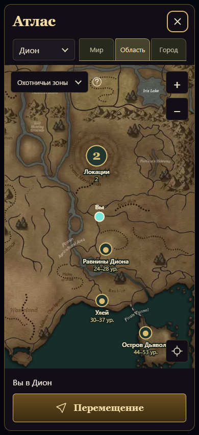
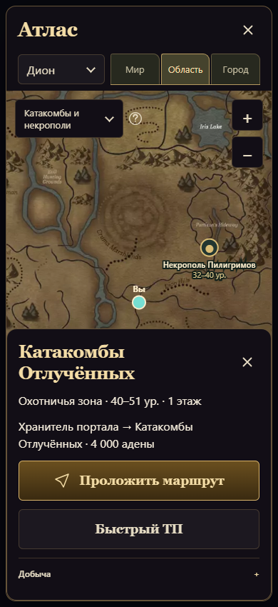
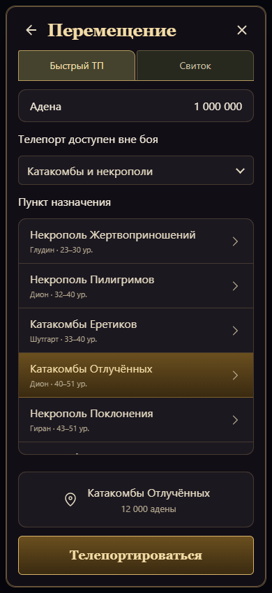

# Атлас — реализация утверждённого макета

Обновление 13 октября 2026: старый экран охотничьих зон и крупная плашка последней добычи удалены. Охота, 6 катакомб и 8 некрополей, рейды, эпики и цели активных квестов открываются в одном атласе. Все 74 поддерживаемые локации используют одну карту; мировой масштаб показывает точки всех регионов. Категории карты совпадают с разделами перемещения.

Добавлены 198 подтверждённых точек боссов: 187 обычных РБ и все 11 поддерживаемых эпиков. Прямой вход к боссу использует существующий бой и серверные ограничения группы, проходки, уровня и отката; повторное присоединение не призывает ещё одного босса. Для Фринтезы отдельно сохранены географический вход и координаты самой комнаты. Квестовые телепорты доступны для активных целей Академии и улучшения оружия; сервер проверяет цель заново и выбирает нужного NPC в боевой комнате.

Источники — [спавны подземелий](https://gitlab.com/MobiusDevelopment/L2J_Mobius/-/tree/9fb01cb20513e55190cdde8d91e41be2c0914f84/L2J_Mobius_CT_2.6_HighFive/dist/game/data/spawns/Catacombs), [SQL обычных РБ](https://gitlab.com/MobiusDevelopment/L2J_Mobius/-/blob/9fb01cb20513e55190cdde8d91e41be2c0914f84/L2J_Mobius_CT_2.6_HighFive/dist/db_installer/sql/game/raidboss_spawnlist.sql) и скрипты комнат эпиков из той же закреплённой версии Mobius High Five. Воспроизводимые импортеры: `scripts/l2j/import-necropolises.mjs` и `scripts/l2j/import-raid-map.mjs`; исходные файлы читаются из `.tmp/world-source` и `.tmp/hf-npcs`.

Пробел данных: у 87 записей РБ текущего каталога нет координат постоянного спавна в этой таблице и загруженных спавнах. Они остаются в списке с явной пометкой и отключённым телепортом. Их список сохранён в `missing-raid-spawns.json`. Координаты не подменяются ближайшей зоной или произвольным местом. Для новых некрополей применяется существующий общий тариф проекта: базовые 20 000 адены, быстрый телепорт по текущему серверному множителю. Это адаптация экономики проекта, а не заявленная оригинальная NPC-цена L2.

Карта, сведения о локации и перемещение разделены на три состояния. На карте остаются масштаб, регион, фильтр, поиск своего положения и одно действие «Перемещение». Сведения открываются нижней панелью; список добычи загружается по запросу. Быстрый телепорт требует выбора пункта и отдельного подтверждения с фактической серверной ценой. Свиток и выход вынесены на отдельную вкладку.

Общие компоненты: заголовок и SVG-крестик `dialog-heading.js`, вкладки, селекты, кнопки, поверхности, список выбора и плашка выбранного пункта из дизайн-системы. Крупные действия используют общий вариант `.prominent`. Навигационные символы не заменяют игровые иконки L2.

Макет определяет структуру и оформление, а карта, положение персонажа, доступные направления и цены берутся из игровых данных. Поэтому география и содержание не являются пиксельной копией нарисованного примера. Сохранены оригинальная карта L2 и реальные координаты.

Проверено на 320, 390 и 820 px: отсутствие переполнения, раскрытие сведений, подтверждение стоимости, ограничения телепорта, свиток, Alt+B, Escape, возврат фокуса, reduced motion и работа перемещения при недоступном canvas. Дополнительно проверены город, клан-холл, владения и возвращение после смерти на 320, 390 и 1280 px. Неподвижная карта не запускает постоянную анимацию.

