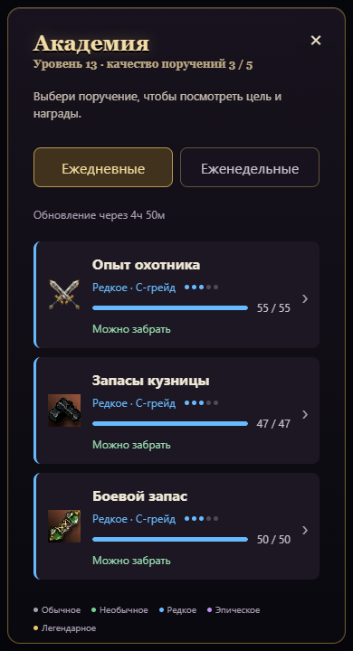
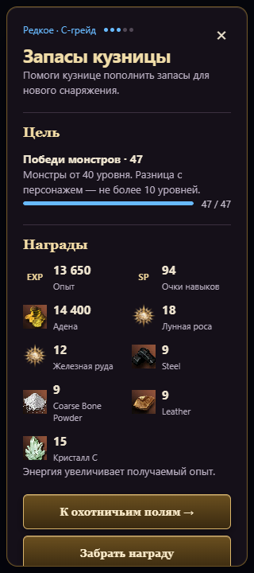

# Баунти: список и отдельный попап

В Академии компактный список с вкладками ежедневных и еженедельных поручений. Цветная полоса и пять точек показывают сохранённое качество задания: обычное, необычное, редкое, эпическое, легендарное. Грейд снаряжения показан отдельно и соответствует уровню персонажа при выдаче.

Каждая строка открывает отдельный попап с целью, прогрессом и сеткой наград в две колонки. EXP обозначает опыт персонажа, SP — очки навыков. Кнопка охотничьих полей открывает существующий экран охоты. Ошибка оставляет попап открытым для повторной попытки. Крестик справа сверху и Escape возвращают к списку.

Ресурсные задания D–S84 выдают 10 / 13 / 15 / 18 / 20 кристаллов своего грейда при качестве 1–5, еженедельные — 40 / 52 / 60 / 72 / 80. В NG грейдовых кристаллов нет. Уже выданные неполученные задания обновляются без сброса прогресса или изменения остальных наград. Полученные задания не оплачиваются повторно.

Проверки: 16 сценариев Chromium (320 и 390 px, NG–S84, все пять качеств), получение награды при двойном нажатии, обновление HUD, закрытие крестиком и Escape, повторный переход к охоте после ошибки. Проверено открытие Академии и заданий профессий с повторной попыткой при HTTP 503. Переполнения по горизонтали и ошибок JavaScript нет. API в браузерных проверках использует локальные фикстуры с реальным расчётом баунти; производственный сервер этими проверками не проверяется.

Полный набор: 964 теста пройдены. Проверка переводов: 0 пропущенных фраз.
