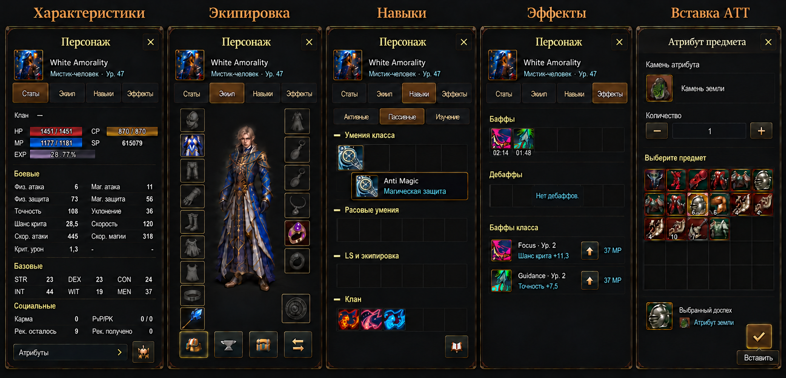

# Персонаж и вставка ATT — макет

Концепт создан встроенным imagegen по скриншотам проекта и оригинальным окнам Inventory, Status и Attribute Enchant L2. Реализация окна персонажа и ATT описана в [отчёте со скриншотами](implementation/README.md). Числа в макете — примеры; реализация получает их из состояния персонажа. Изображение не заменяет оригинальные игровые файлы иконок.

## Общие компоненты и отступы

- Общий заголовок и центрированный крестик, компактные вкладки, квадратные кнопки-иконки, единые строки и поверхности. Использовать существующие компоненты и `design-system.css`.
- Внешнее заполнение компактного окна — 16 px; между блоками — 12 px; между связанными контролами — 8 px. Все значения из `--space-*`. Внутреннее заполнение строк — 12 px. Текст и числовые значения отделены от обеих границ.
- Кнопки-иконки имеют сенсорную область минимум 44 × 44 px. Глиф расположен по центру, с заполнением со всех сторон. Иконки, подписи и значения в строке выровнены вертикально.
- Подсказки показаны на макете как открытые состояния. В интерфейсе они всплывают по наведению, фокусу или нажатию и не резервируют место в потоке. Названия действий доступны через `aria-label`.
- Сетки навыков и предметов сплошные, без промежутков между квадратными ячейками. Иконки сохраняют пропорции. Пустые ячейки инвентаря остаются тёмными. Фоны пустых слотов экипировки используют оригинальные нейтральные серые обозначения слотов L2UI; цветные картинки конкретных вещей для них не подходят.

## Расположение экипировки

Слева строго восемь ячеек: голова, верх, низ, руки, ноги, плащ, майка, пояс. Справа: один костюм, затем левая серьга, правая серьга, ожерелье, левое кольцо, правое кольцо. Снизу отдельно оружие слева и вторая рука справа. Украшений головы в проекте нет. Костюм — декоративный наряд без влияния на характеристики.

Фигура персонажа целиком видна и отображается с сохранением исходных пропорций (`object-fit: contain`), без растяжения по высоте, обрезки головы или ног. Нижние действия: инвентарь, кузница, хранилище и обмен — через компактную общую панель иконок. Выбор предмета открывается нажатием на слот.

Постоянных подписей слотов и текста «Слот свободен» нет. Название слота доступно через подсказку по нажатию, наведению и фокусу; для доступности сохраняется `aria-label`. Слева всего девять квадратов: восемь доспешных слотов и оружие.

## Характеристики

За основу взято нижнее окно Status предоставленного референса L2. Внутри вкладки расположены клан, компактные HP/MP/CP, EXP и SP, затем боевые параметры в двух колонках, STR/DEX/CON и INT/WIT/MEN, социальные параметры. Атрибуты доступны через раскрытие. Эти полосы находятся внутри вкладки характеристик, а не в общем хедере страницы героя.

## Навыки и эффекты

Активные, пассивные и изучение — компактные вкладки. Группы навыков и их названия сохраняют разделение L2; детали открываются тултипом. Книга и заточка — одна кнопка-иконка. Баффы и дебаффы — общие сетки; применение баффа класса — отдельная компактная иконка действия. Постоянные эффекты находятся в пассивках: «Клан» отдельно, «LS и экипировка» вместе. В «Эффектах» остаются временные баффы, дебаффы и применение баффов класса. Focus и Guidance не относятся к пассивкам. Пустые группы в макете иллюстрируют разделение; при реализации скрытые сведения не резервируют место.

## Источники иконок и ограничение макета

`original-icons.html` и `original-icons.png` показывают реальные файлы опубликованного набора проекта: Focus (`skill1077`), Guidance (`skill1240`), Anti Magic (`skill0146`), Clan Body / Spirituality / Soul (`skill0370`–`skill0372`) и шесть оригинальных камней атрибута. Названия пассивок сверены с локальными XML High Five.

При создании макета отдельные текстуры серых пустых слотов ещё отсутствовали. Затем они были извлечены из `L2UI_CT1.utx` и опубликованы в `webapp/art/l2ui/slots`: реализация использует эти исходные файлы. Нарисованные в макете символы не используются как игровые текстуры. Нанесённые тату используют отдельные иконки `_symbol_` из клиента, а не предметные иконки красок `_hena_`.

## Вставка ATT

Отдельное окно по оригинальному Attribute Enchant: выбранный камень, количество, общая сплошная сетка подходящих предметов, выбранный предмет и одна кнопка подтверждения. Закрытие только крестиком заголовка. Шансы, ограничения, совместимость и расход предметов берутся из действующей серверной механики и проверенных данных H5, а не из нарисованного макета. В реализации использовать настоящие иконки камней и конкретные названия предметов из каталога.

Макет не требует WebGL, декоративных таймеров или тяжёлых эффектов. При реализации обязательны проверки на 320 px, широком экране, сенсорном управлении и reduced motion.
