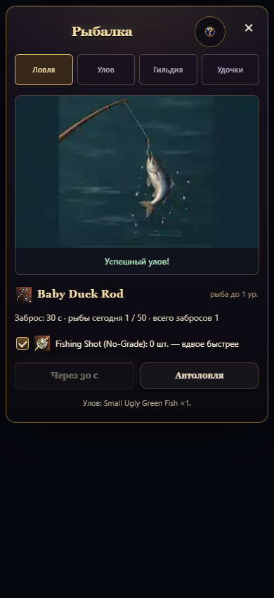
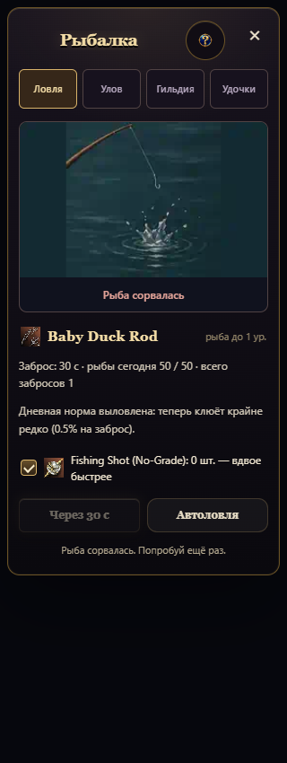

# Лёгкая анимация рыбалки

Сцену с персонажем и пейзажем заменили на воду, край удочки, поплавок и одну модель серебристой рыбы. Успех показывает рыбу на леске; неудача — срыв, всплеск и пустой крючок. Изображение рисованное и растровое. Результат определяет сервер, анимация только отображает его.

| Параметр | Было | Стало |
| --- | ---: | ---: |
| Весь комплект, включая статичные кадры | 608 746 байт | 22 868 байт |
| Разрешение кадра | 384×256 | 256×160 |
| Ожидание до заброса | 6 кадров по кругу | 1 статичный кадр |
| Ожидание поклёвки | 4 кадра | 3 кадра, 2,5 кадра/с |
| Самая большая анимация | 129 160 байт | 5 010 байт |

Комплект уменьшился в 26,6 раза; пикселей в кадре на 58% меньше. Это размеры файлов и кадров, а не измерение FPS или памяти конкретного устройства. Тяжёлый PNG-исходник используется только для пересборки и не загружается игрой.

Для уменьшенной анимации добавлены отдельные статичные кадры успеха и неудачи. В скрытой вкладке и при `saveData` анимация также заменяется соответствующим статичным изображением. При возвращении во вкладку обычный режим восстанавливается. До заброса анимация не декодируется вообще.

Проверено: 17 тестов (механика рыбалки, бюджет изображений и дизайн-система), 8 браузерных сценариев (320/390 пикселей × обычная/уменьшенная анимация × успех/неудача). Проверены загрузка кадров 256×160, один серверный заброс, переключение в статичный режим при скрытии вкладки, Escape и отсутствие горизонтальной прокрутки. Недостающих переводов нет.

Пересборка: `node scripts/ui/build-fishing-webp.mjs`, нужен Python с Pillow (путь можно задать переменной `PYTHON`). Точные границы рисованных кадров и параметры кодирования сохранены в `scripts/ui/encode-fishing-webp.py`.
