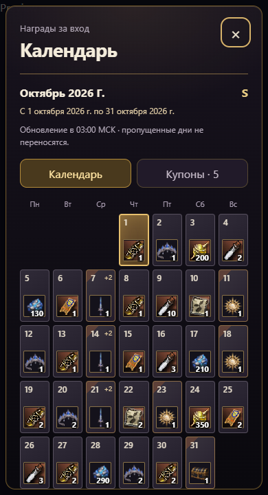
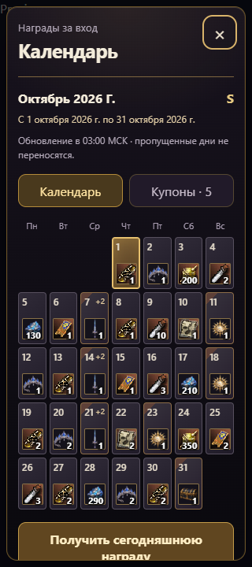

# Календарь наград: оформление по референсу

Вместо условных символов — иконки наград и количество в компактных клетках. Число месяца находится сверху слева, награда — снизу справа. Сегодняшняя дата выделена золотом, полученная награда отмечена галочкой без замены иконки. Особые награды выделены уголком; у комплектов есть метка дополнительных предметов. Нажатие на дату открывает полный состав награды.

Над сеткой указан период с первого по последнее число текущего месяца. Даты берутся из серверного периода, поэтому часовой пояс устройства не сдвигает календарь. В деталях награды также показывается полная дата. Сетка начинается с соответствующего дня недели; лишних дней 32–35 нет. Обновление осталось в 03:00 МСК.

Экономика, порядок наград и правила выдачи не изменены.

## Проверки

- 38 тестов механики наград прошли.
- 16 браузерных сценариев: ширины 320/390 пикселей и все 8 грейдов. Проверены иконки, количество, отметки получения, переходы, купоны, защита от повторного нажатия и отсутствие горизонтальной прокрутки.
- Дополнительно проверены реальные даты и последний день февраля 2027 (28 дней), февраля 2028 (29 дней) и ноября 2026 (30 дней). При открытии 15-го числа выделяется именно 15-е, а не порядковый день входа.
- Ошибок JavaScript и недостающих узбекских переводов нет.

Результаты браузерных сценариев: [verification.json](verification.json).
