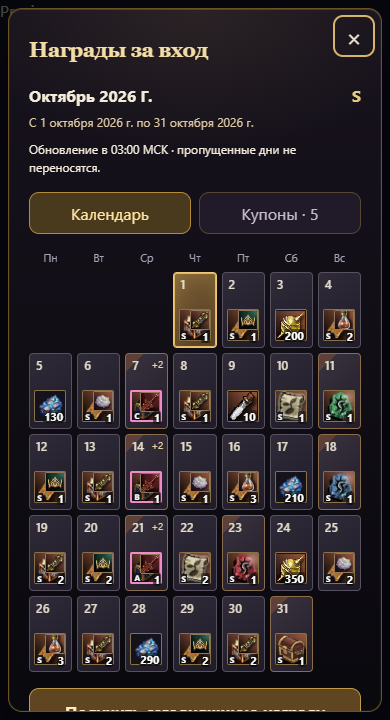
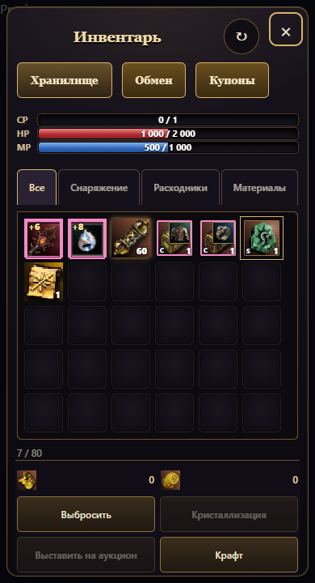

# Иконки паков и теневые предметы

Все 12 видов купонов имеют отдельный вид из растровых WebP-иконок локального L2-пака. Для наборов показаны упаковка и содержимое, для талонов — талон и назначение; руны дропа, опыта и крафта различаются изображениями. Грейд подписан внутри иконки. Один и тот же рендер используется календарём и инвентарём через `materialIcon`. Эмодзи и SVG для этих иконок не используются.

Теневые предметы, включая оружие и эпическую бижутерию, помечаются розовой рамкой в сумке, деталях предмета и общем рендере снаряжения. Купоны на теневые комплекты имеют такую же рамку. Обычные копии предметов её не получают. Признак берётся из серверного поля `shadow`.

Календарь использует общую оболочку `game-popup.js` и существующий `dialogHeading`. Оболочка отвечает за заголовок, закрытие по кнопке и фону, показ и блокировку закрытия во время операции. Кнопка закрытия имеет общий размер 34 пикселя и положение сверху справа; индивидуальные стили крестика календаря удалены. Фокус, Escape и изоляция фона обслуживаются существующим общим механизмом доступности попапов.

Проверено: 59 тестов, 16 браузерных сценариев (320/390 пикселей × 8 грейдов), реальные даты коротких месяцев. Проверяется загрузка всех изображений купонов, выдача и розовая рамка теневого оружия и эпика, отсутствие SVG в иконках, защита от повторных нажатий, закрытие Escape и отсутствие горизонтальной прокрутки. Недостающих узбекских переводов нет.

